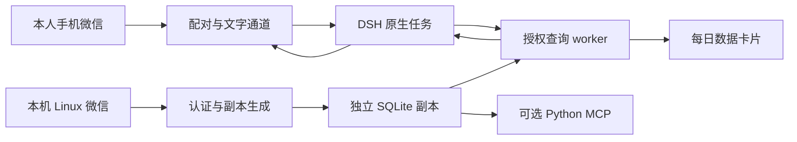

# 架构与数据口径

微信通信、历史采集与历史查询有不同副作用，因此使用独立模块：通信调用微信接口；采集经系统认证生成副本；查询只读取授权副本。原生 DSH 会话负责模型执行和日志，插件复用其目录、模型选择、任务与界面能力。

## 模块

| 模块 | 职责 |
| --- | --- |
| `plugin/lib/client.js` | 原生微信入口、连接界面、设置与可视化卡片 |
| `conversation-controller.js` | Owner RPC、任务关联、来源授权与生命周期 |
| `native-session-bridge.js` | 宿主会话创建、恢复、输入关联、持久化及取消 |
| `weixin-api.js` / `weixin-channel.js` | 协议请求、配对、消息队列与发送状态 |
| `local-history.js` | 导入、搜索前刷新与每分钟空闲检查 |
| `archive-access.js` / `archive-query-worker.js` | 授权范围、预算与独立副本查询 |
| `daily-cards.js` | 每日统计、摘要、引用、来源分类与调度 |
| `scripts/prepare_local_history.py` | 本机微信发现、认证、构建核验与副本生成 |
| `wechat_ro_mcp/` | 独立 Python stdio 查询适配器 |

## 副本更新

变化检查读取数据库和 WAL 的文件身份、大小、时间等元信息；发生变化后才生成校验过的独立副本。查询的一次模型回合固定副本代次，避免分页跨代次。更新失败保留原副本，向调用方提供实际状态。

自动缓存保留最近两份副本及活跃任务仍占用的代次。文件和账号身份变化需重新导入；后台刷新复用已核验密钥，首次取钥在明确导入动作中调用系统认证。

原生路径保护按当前宿主用户的 `Documents/xwechat_files` 解析，并支持显式配置的原库路径。查询侧不把原库路径当成解密副本。

## 时间、覆盖与引用

| 字段或展示 | 含义 |
| --- | --- |
| `localTime` | 消息时间，显示 `+08:00` |
| `read_at` / `snapshot_time` | 查询读取时间 |
| `captured_at` / `snapshot_id` | 副本采集时间与代次 |
| `has_more` | 当前查询还有后续页面 |
| `scan_complete` | 声明范围的扫描是否完成 |
| `total_is_exact` | 总数是否可当作精确结果 |
| 记录引用 | 返回结果关联到来源会话和原文记录 |
| 摘要覆盖范围 | 实际参与摘要的有界记录范围 |

不可读取或未知数量保留状态与说明；发送者字段表示记录发送者。公众号和服务号来自已导入的联系人及业务元数据，跨来源条目保留对应引用。

## 当前工程取舍

使用现有原生 Task、队列和查询 worker，公开 CI 先运行已能独立复现的七项门禁。完整宿主打包与 SDK 测试环境需要后续固定可分发版本；这是当前集成可复现性的技术债。

每日摘要采用有界摘录，能控制现有查询预算，但尚未覆盖完整全天摘要。待办状态、重启自动恢复及朋友圈、小程序接入仍需实现。工作流和验证范围见 [github-workflow.md](github-workflow.md)。
