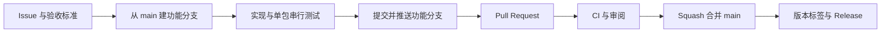

# GitHub 仓库工作流

本项目采用 GitHub Flow：`main` 保存可用版本，短期分支承载修改，通过 PR 和 CI 合并。适用于目前一个主线版本的协作；出现并行维护多个发布版本的实际需求时，再引入维护分支。



## 1. 仓库与本地开发

公开仓库：[keerzzz/dsh-wechat-ro](https://github.com/keerzzz/dsh-wechat-ro)，默认分支为 `main`。公开起点包含整理后的实现、测试和文档；早期私有验收历史保存在原本地仓库。

新开发环境从公开仓库克隆：

```bash
git clone https://github.com/keerzzz/dsh-wechat-ro.git
cd dsh-wechat-ro
```

提交前检查实际暂存内容。数据库、密钥、真实聊天、现场截图和本机日志保留在本地；Git 忽略规则不会移除已经提交的历史。

```bash
git status --short
git diff --cached --check
git diff --cached --stat
git ls-files '*.db' '*.sqlite*' '*.log' '.env*' 'key_info.dat' 'wechat-passphrase.json'
```

## 2. GitHub 仓库设置

| 设置 | 配置 |
| --- | --- |
| 合并方式 | Squash merge，合并后自动删除功能分支 |
| 主线入口 | Pull Request |
| 必需检查 | `Plugin offline checks`，来自首次实际成功的 CI |
| 讨论 | 合并前处理未解决讨论 |
| 审批 | 当前单维护者不要求其他人的审批；有第二位维护者后可要求 1 位 |
| 主线保护 | 禁止强制推送和删除 `main` |
| 安全报告 | Private vulnerability reporting |
| CODEOWNERS | `.github/CODEOWNERS` 指定 `@keerzzz` |

分支保护需要首次 CI 返回实际检查名称后设置；当前仓库设置可通过 GitHub Settings 查询。管理员修复仍使用 PR 和检查记录。

### 仓库搜索与 SEO 内容

仓库名与 package 名统一为 `dsh-wechat-ro`。About 描述使用 WeChat、chat history、DeepSeek Harness、daily insight cards 和 read-only MCP 等能力，并写明 Windows/macOS/Linux 是目标平台；Topics 覆盖三平台和对应技术、场景词。平台的当前实现与验收状态以 README 平台表为准。Homepage 链接指向 README 文档入口。

首页包含英文简介、中文功能、快速开始、支持范围、项目结构和许可证；英文指南使用稳定的相对链接。新增能力后同时更新 README、About 与相关 Topics，保持内容与源码一致。GitHub 搜索展示可直接核验；外部搜索引擎的索引与排名由其抓取结果决定。

## 3. 日常开发

```bash
git switch main
git pull --ff-only
git switch -c codex/history-summary
```

分支名称描述一个任务。提交使用 `type(scope): 描述`：

| 类型 | 用途 | 示例 |
|---|---|---|
| feat | 新能力 | `feat(cards): group highlights by source` |
| fix | 修复问题 | `fix(history): preserve valid snapshot` |
| docs | 文档 | `docs(repo): explain GitHub workflow` |
| test | 回归验证 | `test(cards): cover mixed-source citations` |
| refactor | 行为不变的重构 | `refactor(channel): reuse response decoding` |
| chore | 工具与依赖 | `chore(ci): update pinned actions` |

修改后运行与变更相关的门禁，再审阅并提交指定文件：

```bash
pnpm --dir plugin run test:ci
git diff --check
git diff
git add path/to/changed-file
git diff --cached
git commit -m 'feat(cards): group highlights by source'
git push -u origin HEAD
```

明确需要保存整个工作区时可用 `git add -A`；提交前仍检查暂存差异。已推送功能分支需同步主线时，使用 `git fetch origin` 和 `git merge origin/main`，保留共享历史。

## 4. Pull Request 与合并

在 GitHub 创建从功能分支到 `main` 的 PR。默认模板要求说明问题与结果、主要变更、实际验证和重要兼容性变化。普通缺陷及建议使用现有 Issue 表单。

PR 检查通过、讨论处理完后 Squash 合并。Squash 标题沿用提交格式，描述以最终行为为准。多人协作时由另一位维护者审阅；单人项目保留 PR 作为变更与验证记录。

## 5. 自动与人工验证

`.github/workflows/ci.yml` 在 `main` 推送、面向 `main` 的 PR 和手动运行时执行。一个 Linux Job 先检查全仓代码质量，再按顺序运行 plugin 包的离线门禁（含新增内容索引与媒体容器回归），不配置测试矩阵。它安装锁定 Node/pnpm 和锁文件依赖，使用合成输入及只读 GitHub 权限；第三方 Actions 固定到已核对的提交 SHA。

| 自动门禁 | 主要覆盖 |
|---|---|
| `check-quality` | JS/TS、Python、CSS、JSON/YAML 与 Shell 静态检查 |
| `test-weixin-api` | 请求、响应、诊断与错误处理 |
| `test-weixin-channel` | 队列、发送状态与恢复 |
| `test-weixin-updates-diagnostic` | 更新结构及脱敏诊断 |
| `test-local-history` | 导入、刷新、停止和代次 |
| `test-daily-cards` | 日期、统计、引用、来源分类与补跑 |
| `test-archive-access` | 数据范围、分页和查询 worker |
| `test-qr-renderer` | 本地二维码生成与独立解码 |
| `test-package` | 实际 tarball 的入口、依赖文件、采集助手及字节一致性 |

DSH UI、声明一致性及原生会话门禁依赖兼容 SDK，按 CONTRIBUTING.md 在已有开发环境单项执行。手机收到回复、真实历史采集及重启恢复另需现场验收。公开 CI 通过的含义是上述独立门禁通过，不能替代这些环境验证。

技术债：兼容 SDK 尚未纳入可复现的公开 CI 环境。后续固定可分发 SDK 版本后，再扩展 CI；当前先使用已能在干净副本中执行的独立门禁。

## 6. 发布与回退

验收完成后更新 `plugin/package.json`、相关说明和 CHANGELOG。将 Unreleased 条目移入实际版本与日期，按 SemVer 决定主、次或补丁版本；有未完成验收时使用预发布 Release。

```bash
git switch main
git pull --ff-only
pnpm --dir plugin run test:ci
pnpm --dir plugin pack --pack-destination ../dist
git tag -a v0.2.2-rc.1 -m 'Release v0.2.2-rc.1'
git push origin v0.2.2-rc.1
```

`v0.2.2-rc.1` 是当前 package 版本示例；实际发布时使用经过确认的版本。通过 `test-package` 检查实际 tarball 后在 GitHub 创建预发布 Release，附变更、兼容环境、已完成验收及包文件。当前 package 为 `private: true`，不自动向 npm 发布；本次 CI 也不自动打标签、发 Release 或部署。

主线发现问题时新建修复分支，必要时使用 `git revert <commit>` 撤销该提交，再走 PR。公开主线回退保留历史。

## 7. 仓库模板清单

| 文件 | 用途 |
|---|---|
| `README.md` / `docs/README.template.md` | 项目入口与通用首页结构 |
| `CONTRIBUTING.md` | 环境、验证、提交和贡献约定 |
| `LICENSE` / `THIRD_PARTY_NOTICES.md` | MIT 与第三方来源 |
| `SECURITY.md` / `CODE_OF_CONDUCT.md` | 私密问题报告和协作准则 |
| `CHANGELOG.md` | 发布记录 |
| `.github/pull_request_template.md` | PR 描述 |
| `.github/ISSUE_TEMPLATE/` | 故障与功能建议表单 |
| `.github/CODEOWNERS` | 实际维护者归属 |
| `.github/workflows/ci.yml` | 单包串行 CI |
| `.github/dependabot.yml` | 按月提出依赖和 Action 更新 PR |
| `.editorconfig` / `.gitattributes` / `.gitignore` | 格式、换行和本地文件排除 |

## 官方依据

- [GitHub Flow](https://docs.github.com/en/get-started/using-github/github-flow)
- [Actions 工作流语法](https://docs.github.com/en/actions/reference/workflows-and-actions/workflow-syntax)
- [分支保护](https://docs.github.com/en/repositories/configuring-branches-and-merges-in-your-repository/managing-protected-branches/about-protected-branches)
- [Issue 表单语法](https://docs.github.com/en/communities/using-templates-to-encourage-useful-issues-and-pull-requests/syntax-for-issue-forms)
